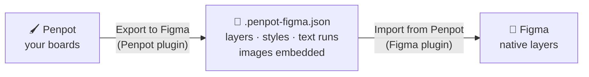

<div align="center">

# ↩️ Return Trip

### Penpot → Figma, as real editable layers.

Design in Penpot. Hand off in Figma. Nothing gets flattened.

[](LICENSE)


[**Quick start**](#-quick-start) · [**How-to guide**](docs/HOW-TO-GUIDE.md) · [**How it works**](#-how-it-works) · [**What carries over**](#-what-carries-over) · [**FAQ**](#-faq)

</div>

<!-- Tip: drop a short GIF here of a Penpot board landing in Figma. It's the best advert this repo can have.
      -->

---

## 🧭 What it does

Penpot already has a great [official plugin](https://github.com/penpot/penpot-exporter-figma-plugin) for moving **from** Figma. **Return Trip goes the other way.** It takes your Penpot boards and rebuilds them in Figma as native frames, text, shapes, Auto Layout and effects, so your developer, client or teammate can work with them like anything else in Figma.

Not screenshots, and not one giant SVG: **real layers you can click into and edit.**

```text
  ┌──────────── Penpot ────────────┐              ┌──────────── Figma ─────────────┐
  │  ▢ Hero board                  │              │  # Hero frame                  │
  │    T  "Let's see what…"        │   ───────▶   │    T  "Let's see what…"        │
  │    ▭  Button (flex row)        │  .json file  │    ▭  Button (Auto Layout)     │
  │    🖼  Product shot             │              │    🖼  Product shot             │
  └────────────────────────────────┘              └────────────────────────────────┘
```

## ✨ Why you'll like it

|   |   |
|---|---|
| ⚡ **Zero setup** | No Node, no `npm install`, no build. Download the folder, load two plugins, done. |
| 🎯 **Export just what you need** | Select a single board, a few layers, or nothing for the whole page. |
| 🧱 **Truly editable** | Frames, groups, text, shapes and vectors all arrive as native Figma layers, keeping their original names. |
| 🔤 **Typography that survives** | Every style run in a text block (font, weight, size, colour, spacing, case) comes across. A two-colour headline stays one text layer. |
| 📐 **Flex → Auto Layout** | Penpot flex boards become Figma Auto Layout, with gaps, padding, alignment, wrap and hug/fill sizing. |
| 🎨 **Gradients done properly** | Linear and radial gradients are re-projected into Figma's gradient maths, so their handles land in the same spots. |
| 🛡️ **Built on official APIs** | Uses Penpot's and Figma's public plugin APIs, not Penpot's internal file format, so a Penpot update is less likely to break it. |
| 🔒 **Private by design** | No servers, accounts or API keys. Your design goes from your computer straight into Figma. |
| 🔍 **Honest about gaps** | Missing fonts and anything it can't convert are listed after every import, not silently dropped. |
| ⏱️ **Fast** | In testing, a 608-layer canvas with images exported in under a second. |

## 🚀 Quick start

> 👋 First time? The **[step-by-step how-to guide](docs/HOW-TO-GUIDE.md)** covers every click, plus troubleshooting.

**1. Get it**

```bash
git clone https://github.com/Christian-VanWyk/penpot-to-figma.git
```

…or **Code → Download ZIP**.

**2. Add the Penpot plugin**

Start the tiny local server that hands the plugin to Penpot:

| Windows | Mac / Linux |
|---|---|
| Double-click `penpot-exporter/start-penpot-plugin.bat` | `python3 penpot-exporter/serve.py` or `node penpot-exporter/serve.mjs` |

Then in Penpot press **Ctrl + Alt + P**, paste `http://localhost:4400/manifest.json`, and click **Install**.

**3. Add the Figma plugin** *(Figma desktop app)*

**Plugins → Development → Import plugin from manifest…** → choose `figma-importer/manifest.json`.

**4. Go!**

```text
Penpot:  select boards  →  Export to Figma  →  Export        ⇢  my-design.penpot-figma.json
Figma:   Import from Penpot  →  choose the file  →  Import    ⇢  ✨ editable layers
```

## ⚙️ How it works



**In Penpot**, the exporter walks your layer tree through the official [Penpot plugin API](https://penpot.app/plugins) and records everything Figma needs to rebuild it:

- **Geometry:** position, size, rotation and constraints.
- **Style:** fills, strokes, radii, shadows, blur, opacity and blend modes.
- **Text, run by run:** every change in font, weight or colour inside a text block becomes its own run.
- **Flex layout settings.**
- **Images:** pulled out of image fills and embedded in the file.
- **Vectors:** paths, booleans and raw SVGs are exported as SVG markup.

**In Figma**, the importer rebuilds each layer with the [Figma plugin API](https://www.figma.com/plugin-docs/), translating the parts that differ between the two tools:

| Penpot says… | Return Trip turns it into… |
|---|---|
| Gradient start/end points + width ratio | Figma's inverse affine `gradientTransform` |
| Font family + numeric weight (`700`, italic) | The best-matching installed style (`Bold Italic`), or the closest weight |
| Flex `justify` / `align` / `gap` / sizing | Auto Layout alignment, spacing and Hug / Fill / Fixed |
| Rotation around the centre | A matching `relativeTransform` |
| Absolute coordinates | Positions relative to the parent frame, the way Figma expects |

The file in the middle is plain, readable JSON (`"format": "penpot-to-figma"`), so you can inspect it, diff it, or build your own tools on top of it.

## 🎨 What carries over

| Penpot | → | Figma |
|---|:-:|---|
| Boards | → | Frames (fill, stroke, radii, clip content) |
| Groups | → | Groups |
| Rectangles, ellipses | → | Rectangles, ellipses |
| Text | → | Text with mixed styles, line height, letter spacing, case, decoration, alignment, auto-width/height |
| Solid, linear and radial gradient fills | → | Same |
| Image fills | → | Image fills (PNG, JPG, GIF) |
| Strokes (inner / centre / outer, dashed, dotted) | → | Strokes |
| Drop shadow, inner shadow, layer blur | → | Effects |
| Flex layout | → | Auto Layout *(optional)* |
| Paths, booleans, SVGs | → | Vector layers |
| Opacity, blend mode, hidden, locked, rotation, constraints | → | Same |

### Not yet

- 🧩 **Components and variants** arrive as plain frames.
- 🔲 **Grid layout** arrives as fixed positions.
- 🔗 **Prototype links, comments and design tokens** aren't exported.
- 📏 **Per-child flex margins** have no Figma equivalent. Positions are still exact.
- 🖼️ **WebP images** aren't supported by Figma and are skipped with a note.

## 🗺️ Roadmap

- [ ] Penpot components → Figma components
- [ ] Grid layout → Figma grid Auto Layout
- [ ] Design tokens → Figma variables
- [ ] Prototype connections
- [ ] Hosted version of the Penpot plugin, so no local server is needed

Want one of these sooner? [Open an issue](../../issues) or send a PR.

## 🧰 Other tools in this space

Return Trip isn't the only option. Here's how it compares to other Penpot → Figma projects I found on GitHub, so you can pick what suits you.

| | **Return Trip** | [Penpot-figma](https://github.com/Subha06-chak20/Penpot-figma) | [figma-design-importer](https://github.com/petercr/figma-design-importer) |
|---|---|---|---|
| Reads | Your live Penpot file (plugin API) | Penpot's `.penpot` export | Penpot's `.penpot` export |
| Build step | **None** | Node + npm build | Node + npm build |
| Export a selection | **Yes** | Whole file | Whole file |
| Auto Layout | Yes | Yes | Not yet |
| Prototype links | Not yet | Yes | Not yet |
| Multiple pages per import | One page at a time | Yes | Yes |
| Needs a local server | While exporting | No | No |

Going the other way? Use Penpot's official **[Figma → Penpot exporter](https://github.com/penpot/penpot-exporter-figma-plugin)**.

## ❓ FAQ

<details>
<summary><b>Why two plugins instead of one?</b></summary>

Penpot's plugin API reads your design exactly as Penpot sees it, including computed text styles and layout settings. Reading Penpot's internal `.penpot` file format instead would skip the Penpot plugin, but that format is undocumented and can change between Penpot versions.
</details>

<details>
<summary><b>Why does the Penpot side need a local server?</b></summary>

Penpot installs plugins from a web address. The included scripts serve the plugin folder at `http://localhost:4400`, and only to your own computer. Run it while you export, close it when you're done.
</details>

<details>
<summary><b>Does it work with the browser version of Figma?</b></summary>

You need the **Figma desktop app** to install a plugin from a folder. After that, it works the same as any other development plugin.
</details>

<details>
<summary><b>Does it work with self-hosted Penpot?</b></summary>

It should. It only uses the standard plugin API, so any Penpot with plugin support can load it.
</details>

<details>
<summary><b>My text looks a bit different. Why?</b></summary>

It's almost always a font that isn't installed for Figma. The importer lists every font it swapped. Install those fonts, restart Figma, and import again.
</details>

<details>
<summary><b>Is my design sent anywhere?</b></summary>

No. The export is a file on your computer, and the Figma plugin has network access turned off in its manifest.
</details>

## 📁 What's inside

```text
penpot-to-figma/
├── penpot-exporter/            🖌️ Penpot plugin
│   ├── plugin.js                   reads the design, builds the export
│   ├── index.html                  the plugin panel
│   ├── manifest.json · icon.png
│   ├── start-penpot-plugin.bat     Windows: double-click to serve
│   ├── serve.ps1                   …the server it runs
│   ├── serve.py                    Mac/Linux: python3 serve.py
│   └── serve.mjs                   Mac/Linux: node serve.mjs
├── figma-importer/             🎨 Figma plugin
│   ├── code.js                     rebuilds the layers
│   ├── ui.html                     the plugin panel
│   └── manifest.json
└── docs/
    └── HOW-TO-GUIDE.md          📖 step-by-step guide
```

Plain JavaScript and HTML throughout. Read it, tweak it, fork it.

## 🤝 Contributing

Bug reports, ideas and pull requests are all welcome. If an import looks off, please [open an issue](../../issues) with:

1. A screenshot from Penpot and from Figma.
2. The `.penpot-figma.json` file, if you're happy to share it.

## 📄 License

[MIT](LICENSE). Use it, change it, ship it.

<div align="center">
<sub>Made for designers who love Penpot but still have to hand off in Figma. 💚</sub>
</div>
